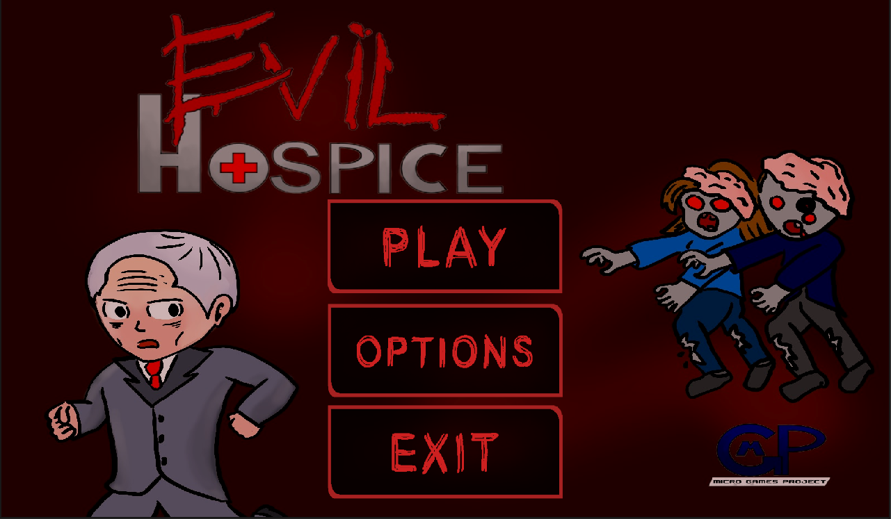
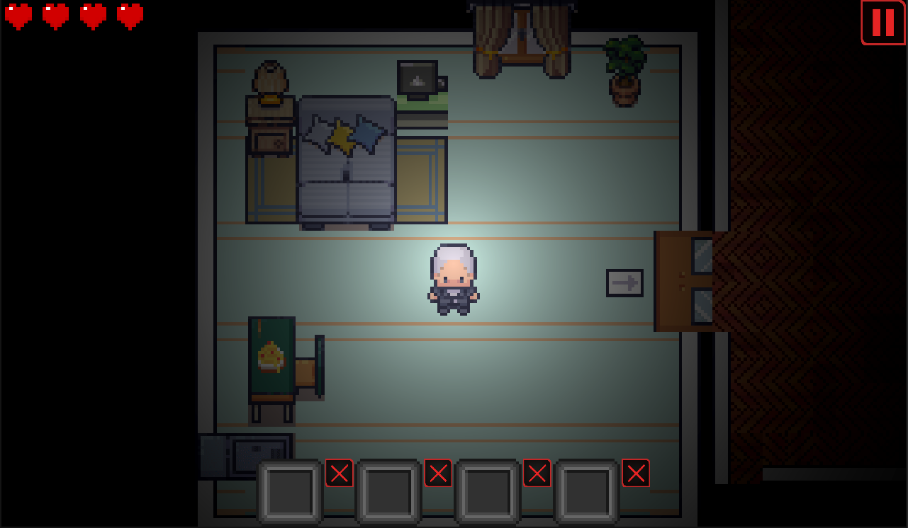
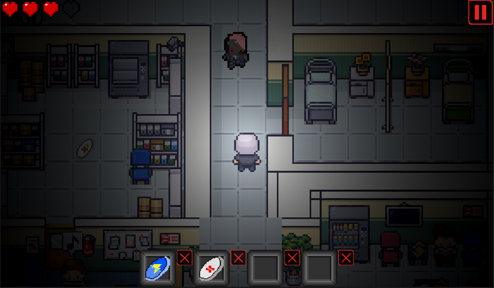
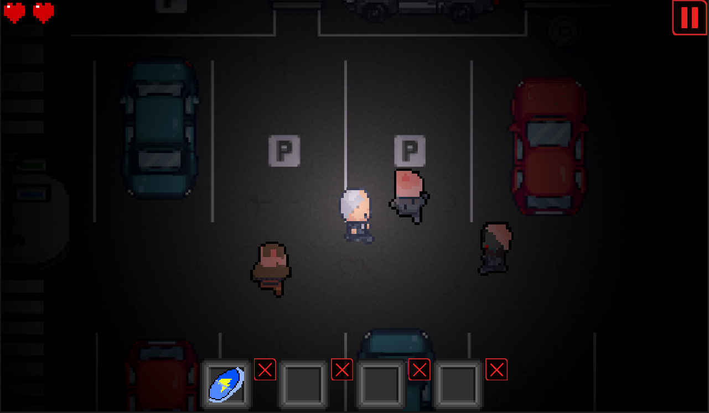

# Evil Hospice

**Evil Hospice** is a 2D top-down stealth-horror game prototype developed in Unity as a university project for the *Sviluppo di Videogiochi* (Video Game Development) course at the University of Bari, Italy, in 2024.

The game follows Bob, a retired secret agent living in a nursing home whose residents have mysteriously turned into zombies after taking an experimental medication. To survive, Bob must navigate the building, avoid enemies, and use limited resources to find his way out.

The project was developed as a single-level playable prototype, focusing on fundamental game development concepts such as player movement, enemy behavior, collision handling, inventory management, and level design.

## Gameplay

The player explores a pixel-art environment from a top-down perspective, navigating rooms and corridors while avoiding zombies.

Different enemy types pose different threats, requiring the player to choose appropriate paths and manage their resources carefully.

### Features

- **Top-down movement:** Explore the environment using WASD controls.
- **Enemy encounters:** Avoid zombies with different movement speeds and damage values.
- **Health system:** Survive enemy attacks by managing the player's four health points.
- **Inventory system:** Collect and use consumable items found throughout the level.
- **Power-ups:** Restore health, temporarily increase movement speed, or gain protection against enemy attacks.
- **Game states:** Main menu, gameplay, victory, and game-over screens.
- **Pixel-art environments:** A nursing home setting with rooms, corridors, and outdoor areas.

The game currently consists of one playable level and was developed as an academic prototype rather than a complete commercial game.

## Screenshots

### Main Menu



### Gameplay — Starting Room



### Gameplay — Corridors



### Gameplay — Outdoor Area



## Controls

| Input | Action |
|---|---|
| W / A / S / D | Move the player |
| Left mouse button | Select and use inventory items |

## Technologies and Tools

| Technology | Purpose |
|---|---|
| **Unity** | Game engine, scene management, physics, and gameplay |
| **C#** | Game logic and scripting |
| **Tiled** | Tilemap creation and level design |
| **LibreSprite** | Pixel-art creation and sprite editing |
| **Visual Studio Code** | C# development |

## Installation and Usage

### Requirements

- Unity Editor (compatible with the project's Unity version)
- Windows or Linux for the existing standalone builds

### Run from Unity

1. Clone the repository:

   ```bash
   git clone https://github.com/guides22/EsameSDV23-24_EvilHospice.git
   ```

2. Open **Unity Hub**.
3. Select **Add project from disk** and choose the `Retirement_Evil` directory.
4. Open the project using a compatible Unity Editor version.
5. Open the main gameplay scene and press **Play**.

### Standalone Builds

The repository also contains previously compiled builds:

- `BuildWindows/` — Windows version
- `BuildLinux/` — Linux version

These builds are retained for archival purposes. They were generated using an older Unity version and should be rebuilt with a security-patched Unity Editor before redistribution.

## Project Structure

```text
EsameSDV23-24_EvilHospice/
├── Retirement_Evil/       # Unity project
│   ├── Assets/             # Scripts, scenes, sprites, audio, prefabs, etc.
│   ├── Packages/           # Unity package configuration
│   └── ProjectSettings/    # Unity project settings
├── BuildWindows/           # Windows build
├── BuildLinux/             # Linux build
├── docs/
│   └── screenshots/       # Gameplay screenshots
├── Evil Hospice by MGP.pdf # Game Design Document
└── README.md
```

## Development and Contributions

Evil Hospice was developed as a group project by three students at the University of Bari.

- **Guillaume Desaphy** — Primary developer, game design, gameplay implementation, and level design.
- **Mirko Pepe** — Game design, graphic design, and level design.
- **Pietro Conca** — Game design and level design.

The project involved designing the gameplay mechanics, implementing the game systems in Unity, creating and adapting pixel-art assets, and building the playable level.

## Assets and Credits

The game combines original artwork created for the project with freely available third-party assets, including environmental tiles, interface elements, and audio resources.

Third-party assets retain their respective authors' rights and applicable license conditions.

## Project Context

This repository preserves the final academic prototype developed for the 2023–2024 Video Game Development course.

The objective was to gain practical experience with Unity and C#, covering the main stages of game development, from initial game design and asset creation to gameplay implementation and level construction.

The original Game Design Document, written in Italian, is available in the repository: [Game Design Document](Evil%20Hospice%20by%20MGP.pdf).
